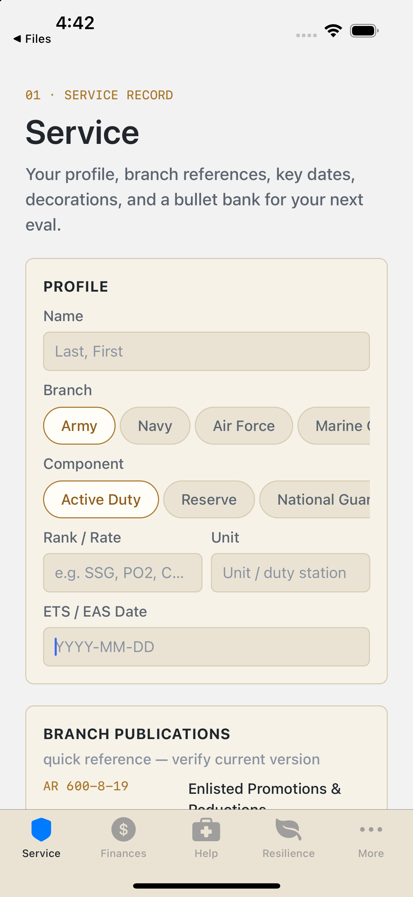
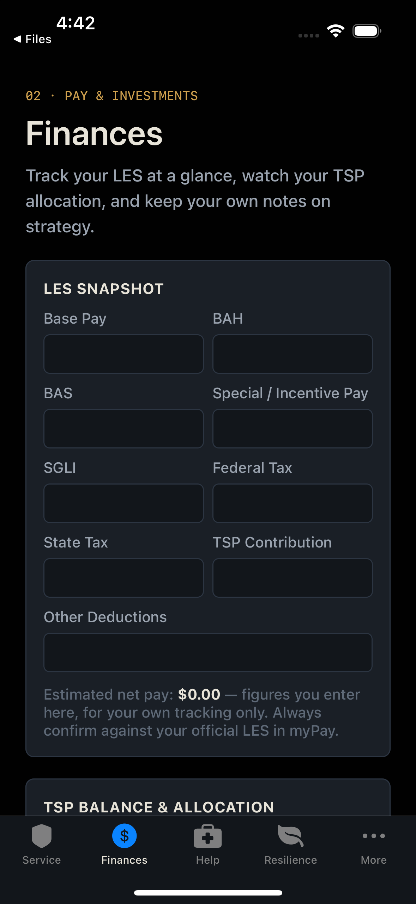
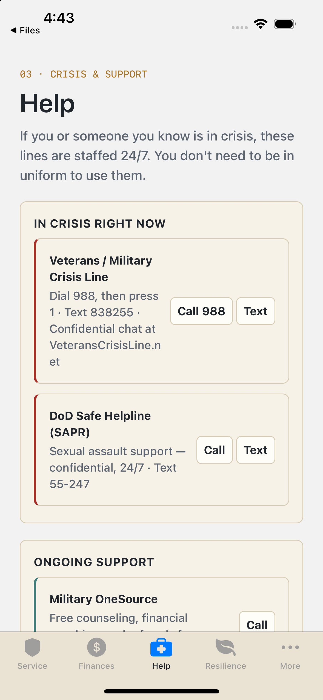
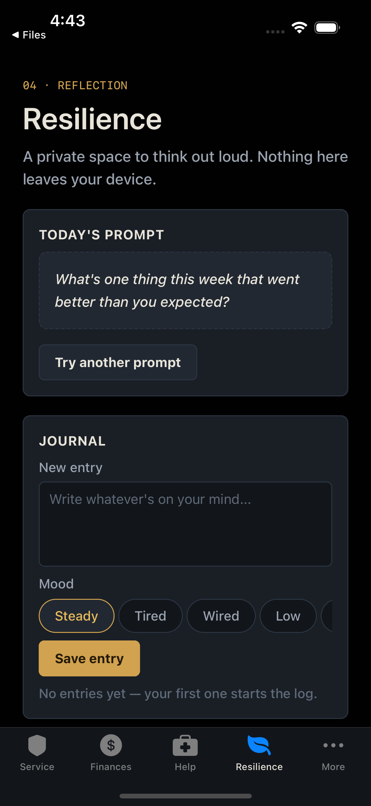

# Battle Buddy

A private, offline-first iOS app for service members who are serving, separating, or retiring. It keeps the records, deadlines, and paperwork of a career in one place, and nothing leaves the phone.

> **Status: working prototype.** It runs and the core flows work, but it has not been security-audited and it is **not an accredited system for handling official CUI or PII**. Treat it as a proof of concept.

<p align="center">
  
  
  
  
</p>

## Why this exists

I built Battle Buddy because separating or retiring is full of deadlines nobody tells you about until you're already inside the process. I didn't know the timelines for filing a BDD claim, and other service members have told me they didn't know SkillBridge's either, which can cost you benefits or opportunities at the worst possible time. Battle Buddy is an offline, encrypted place to keep the records that matter (reenlistments, decorations, medical records) alongside a checklist of what's coming, with nothing stored in the cloud. My goal is fewer surprises for service members who are already under enough stress.

## What it does

Six tabs, all stored locally and encrypted:

| Tab | What's in it |
|---|---|
| **Service** | A **"Where you are"** card that turns your ETS/EAS date into your transition phase and the next deadlines (TAP, BDD, health assessment, GI Bill transfer, then SGLI/VGLI, TAMP and the VA claim window), plus profile (branch, component, rank, unit, ETS/EAS), branch publication references, key dates, awards and decorations, and a **bullet bank** for the next EPR / OPR / NCOER / FITREP |
| **Finances** | LES snapshot with estimated net pay, TSP balances and fund allocation, and free-form investment notes |
| **Help** | One-tap crisis lines (Veterans/Military Crisis Line, DoD Safe Helpline), ongoing support (Military OneSource, TRICARE Nurse Advice), and a place for your own SARC / Victim Advocate contacts |
| **Resilience** | A private journal with mood tracking, rotating reflection prompts, and mental-health resources |
| **Departure** | A 13-step separation/retirement checklist and a BDD claim appointment tracker |
| **Documents** | An encrypted repository for receipts, contracts, and BDD paperwork (`.pdf`, `.jpeg`, `.docx`, up to 25 MB each) |

A crisis line (988, press 1) is reachable from the lock screen, before you have to unlock anything.

## How your data is protected

- **Everything is encrypted at rest.** Profile, pay, journal, SAPR contacts, BDD notes, and the document list live in a single vault encrypted with **AES-256-GCM**.
- **The key comes from your password.** PBKDF2-HMAC-SHA256 (210,000 iterations, random 16-byte salt) derives the key. The password and key are never written to disk.
- **Documents are encrypted too.** Each file is encrypted with the vault key before it is stored (as a `.bbenc` file). It is decrypted only into a temporary copy when you tap Share, and that copy is cleared when the vault locks, before the next share, and when the app starts.
- **No network access.** The app code makes no network requests, has no accounts, and includes no analytics or crash reporting. The only outbound actions are `tel:` and `sms:` links you tap yourself.
- **No password recovery.** If you forget the password, the data cannot be decrypted. The app says so before you set one.

Implementation lives in [`src/lib/vault-crypto.ts`](src/lib/vault-crypto.ts), [`src/lib/vault-storage.ts`](src/lib/vault-storage.ts), and [`src/context/vault-context.tsx`](src/context/vault-context.tsx).

### Known limits (be honest about these)

- **Locking is basic.** A **Lock** button sits at the top of every screen, and the vault locks itself after 60 seconds in the background. Pending edits are saved before it locks. While the app is unlocked and not in the foreground, an opaque cover replaces the screen, so the iOS app-switcher snapshot shows only the app's mark and none of your data.
- **No biometric unlock.** `expo-local-authentication` and `expo-secure-store` are installed but not used yet.
- **Key derivation runs in JavaScript.** The iteration count (210,000) is lower than a native implementation would use and has not been benchmarked on a physical device. In a debug build on the simulator, creating the vault took roughly 20 to 30 seconds with no progress indicator. I haven't timed a release build.
- **The share sheet works on a decrypted temporary copy.** It exists on disk until the vault locks, you share another file, or the app restarts. iOS may also leave its own temporary copy of a picked file in the app's `tmp/` folder.
- **Not audited, and not accredited** for CUI or official records. Don't put anything in it you aren't willing to risk in a prototype.

## Reference data you should verify

The checklist items, publication numbers, filing windows, and phone numbers are entered by hand from public sources and **may be wrong or out of date**. Each screen says "verify current version" where it matters, but the source of truth is always the official one (VA.gov, MilitaryOneSource.mil, your installation's TAP/transition office). As of 2026-10-31, these were checked against official pages: the crisis and support phone numbers; the BDD window (180 to 90 days before separation); the TAP (365 days), health assessment (90 days) and GI Bill transfer rules in the checklist; and the branch publication numbers and titles, several of which had been renamed or split (for example Space Force now has its own evaluation and dress instructions). The post-separation windows on the "Where you are" card (SGLI, VGLI, TAMP, CHCBP, VA claim and VA health care) were checked against VA and TRICARE pages on 2026-11-01 and live in one file, [`src/lib/transition-timeline.ts`](src/lib/transition-timeline.ts), with that date recorded in it. Two are the least settled: VA says up to 10 years of health care for combat-theater veterans, but older pages say 2 or 5, and TAMP covers only certain separation types. **Not individually confirmed:** the current NAVPERS 15665 edition, and the SGLI, household-goods, finance, TRICARE, DEERS and transcript checklist items. The app lists publication numbers only, not revision letters, because those change often. Pull requests that correct this data are the most useful contribution.

## Tech stack

- [Expo](https://expo.dev) SDK 57, React Native 0.86, TypeScript, Expo Router (native tabs)
- `expo-crypto` for AES-256-GCM, `@noble/hashes` for PBKDF2
- `expo-file-system`, `expo-document-picker`, `expo-image-picker`, `expo-sharing` for the document repository
- State is a single React context (`VaultProvider`) that holds the decrypted data in memory and re-encrypts on a debounced save

## Run it

You need a Mac with Xcode and CocoaPods installed.

```bash
git clone https://github.com/mzsicecold/battle-buddy.git
cd battle-buddy
npm install
npx expo run:ios
```

The first build compiles the native modules and takes a while. It has been built and exercised on the **iPhone 15 Pro simulator (iOS 17.4)**. Android, Expo Go, and physical devices are untested.

The simulator starts with no files to pick from. To test **Add Photo**, load an image with `xcrun simctl addmedia booted <image>`. To test **Choose File**, put a PDF in the Files app's "On My iPhone" storage.

## Tests

```bash
npm test
```

38 tests (about 5 seconds, Node 22+ needed, no extra dependencies). The first 19 cover `src/lib/vault-crypto.ts`: round trip, wrong or near-miss passwords, the stored file format (random salt, no password or plaintext on disk, iteration count honored), tamper detection on ciphertext, salt, and truncation, IV freshness on every save, password change, and encryption of document bytes. I also confirmed the tests can fail by deliberately breaking the code three ways (ignoring the stored iteration count, using a fixed salt, skipping re-keying on password change) and checking that the right tests caught each.

19 more tests cover `src/lib/transition-timeline.ts`, the logic behind the "Where you are" card: strict date parsing (impossible dates like 2027-02-30 are rejected), the phase boundaries, each deadline counted from a sample date, a leap-day edge case, and which missed windows get a note. Three deliberate breakages (a phase boundary off by one, the leap-day rule removed, a deadline shifted by 40 days) were each caught. The card itself was checked by eye in the simulator.

**What they don't cover:** the app uses a native AES module that doesn't exist in Node, so the tests run against a stand-in built on `node:crypto` that follows the same IV + ciphertext + tag format. They verify this repo's logic, not the native module, and they don't replace testing on a device. The vault context (saving, locking) and the screens have no automated tests yet.

## Roadmap (not built yet)

- Biometric unlock
- Benchmark and tune key derivation on a physical device
- Automated tests for the vault context (debounced save, lock flush) and a device test of the native AES path
- Verify and source-cite all reference data
- An **opt-in** Claude-assisted bullet rewriter. The open design question is how to offer it without breaking the "nothing leaves your device" promise: off by default, send only the single line the user selects, store nothing, and say so plainly in the UI.

## License

MIT. See [LICENSE](LICENSE).
